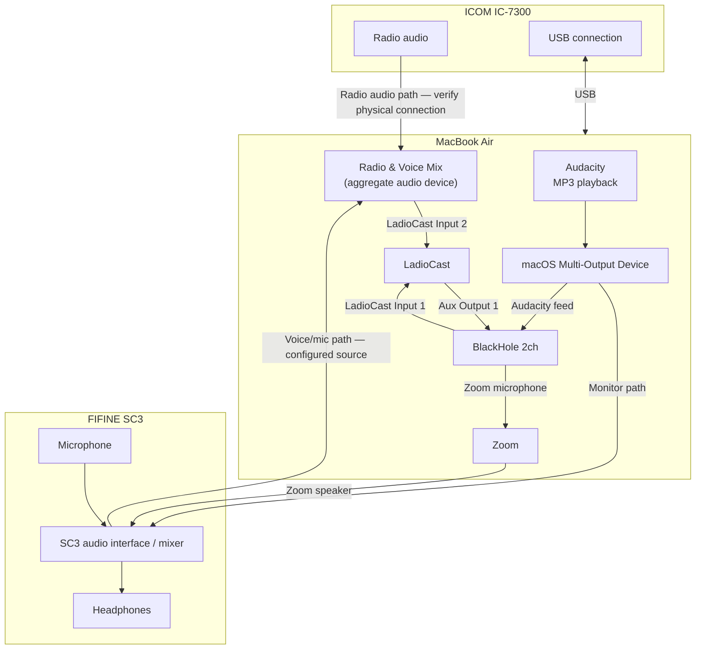

---
{"dg-publish":true,"permalink":"/ham-radio/equipment/fifine-sc-3/audacity-radio-fifine-zoom-routing/","title":"Audacity, Radio, FIFINE SC3, and Zoom Audio Routing","tags":["audio","audacity","zoom","ham-radio","obsidian"],"dg-note-properties":{"title":"Audacity, Radio, FIFINE SC3, and Zoom Audio Routing","tags":["audio","audacity","zoom","ham-radio","obsidian"]}}
---

# Audacity, Radio, FIFINE SC3, and Zoom Audio Routing

## Purpose

This note documents the current audio routing used to send both Audacity playback and microphone/radio audio to Zoom, while monitoring audio through the FIFINE SC3 headphones.

## Routing schematic

## Signal paths

### 1. Audacity playback

Audacity sends playback to the macOS **Multi-Output Device**. That device sends the audio to:

- **FIFINE SC3** so it can be heard through the headphones.
- **BlackHole 2ch** so it can be received by LadioCast.

### 2. Microphone and radio audio

The microphone/radio source is provided to LadioCast through **Radio & Voice Mix**, connected as LadioCast Input 2.

The exact physical connection carrying IC-7300 audio into Radio & Voice Mix should be confirmed against the Audio MIDI Setup device configuration and cabling. This diagram identifies the logical source, not an independently verified cable path.

### 3. Combined audio sent to Zoom

LadioCast combines:

- Input 1: **BlackHole 2ch** (Audacity playback)
- Input 2: **Radio & Voice Mix** (microphone/radio source)

Both inputs are routed to **Aux Output 1**, which is **BlackHole 2ch**. Zoom uses BlackHole 2ch as its microphone input.

### 4. Audio heard locally

- Audacity is monitored through the Multi-Output Device to the FIFINE SC3.
- Zoom return audio is sent from Zoom to the FIFINE SC3.
- Headphones are connected to the FIFINE SC3.

## Device and application settings

### Audacity

- Host: **Core Audio**
- Playback Device: **Multi-Output Device**

### macOS Audio MIDI Setup

**Multi-Output Device**
- BlackHole 2ch: enabled
- FIFINE SC3: enabled
- Primary Device: FIFINE SC3
- Sample rate previously set to 44.1 kHz

### LadioCast

| Setting | Value |
|---|---|
| Input 1 | BlackHole 2ch |
| Input 2 | Radio & Voice Mix |
| Main Output | FIFINE SC3 |
| Aux Output 1 | BlackHole 2ch |
| Input 1 → Main | OFF |
| Input 2 → Main | OFF |
| Input 1 → Aux 1 | ON |
| Input 2 → Aux 1 | ON |

The Main routing buttons are OFF because the combined outgoing feed is sent through Aux Output 1. The Main output is not being used for these two sources.

### Zoom

- Microphone: **BlackHole 2ch**
- Speaker: **FIFINE SC3**
- **Share Computer Sound** is not needed for this microphone-mix routing.

## Important distinction: local monitoring vs. Zoom feed

- **Aux Output 1 / BlackHole 2ch** controls the combined audio feed sent to Zoom.
- **Multi-Output Device / FIFINE SC3** provides local Audacity monitoring.
- **Zoom Speaker / FIFINE SC3** returns meeting audio to the headphones.
- LadioCast Main Output is not carrying Inputs 1 and 2 while their Main buttons are OFF.

## Verification checklist

- [ ] Audacity playback is audible in the FIFINE SC3 headphones.
- [ ] Zoom's microphone meter moves when Audacity plays.
- [ ] Zoom's microphone meter moves when speaking into the microphone.
- [ ] Zoom Test Mic playback contains both Audacity and microphone audio.
- [ ] Neither source sounds distorted or clips.

## Notes

The routing above reflects the configuration that was tested and reported working. The physical IC-7300-to-Mac audio connection is not fully established by the available information; verify that path before treating the schematic's radio connection as a literal cable diagram.
